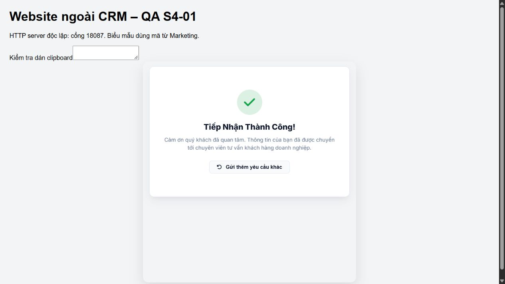
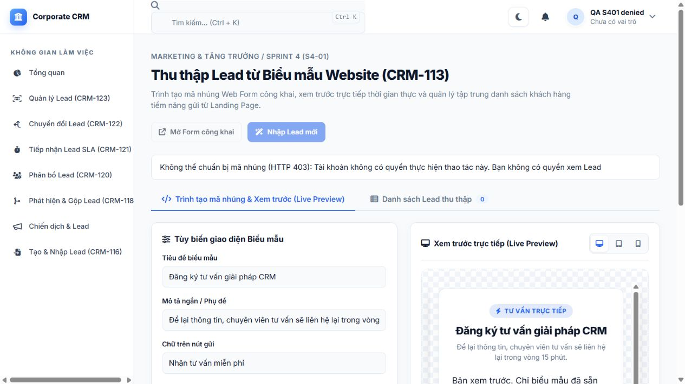
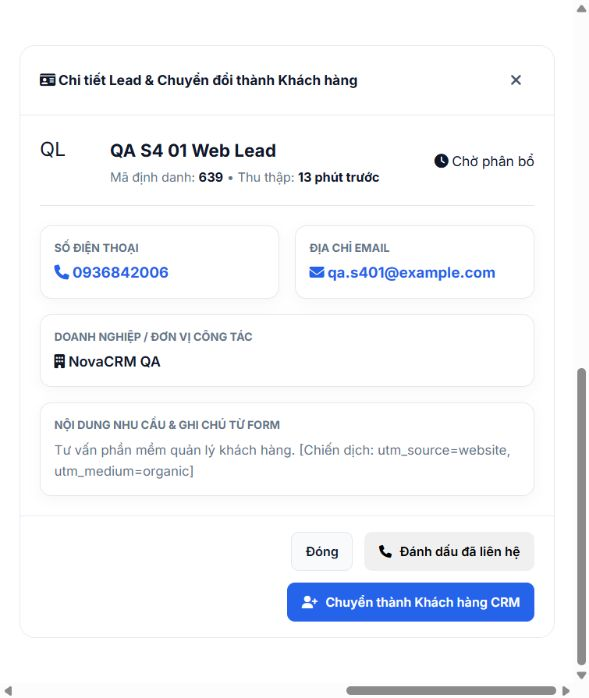

# S4-01 browser QA follow-up

Verified 2026-10-17, Asia/Bangkok, against a dedicated Tomcat 10.1.60 on port
18086 and MySQL 8.4.9 schema `crm_sprint1_test_s401_full_20261017`.
The development `crm_db` was inspected read-only; no QA submissions were sent there.

## Behavior fixed

- Show the Lead Capture menu only when the authenticated session has `lead.read`.
  Backend authentication and permission checks remain in force.
- Keep appearance preview available while registration is loading or unavailable,
  with submission disabled for an unregistered preview. Enable public/copy actions
  only after receiving a registered form. Explain preparation/list errors and allow
  appropriate retries without discarding the last successfully loaded Lead list.
- Hide the Lead detail modal until opened, and support opening/closing it on mobile.
- Display `PENDING_ASSIGNMENT` as “Chờ phân bổ”; never label unknown states “Mới”.
- Version manager assets after deployment and report clipboard fallback failures.

All modified production files belong to S4-01; the shared shell change is limited
to its Lead Capture menu. No other Sprint 4 backend behavior is changed here.

## Executed evidence

The external website on `127.0.0.1:18087` embedded the actual generated iframe from
`localhost:18086`. A browser submission returned HTTP 201 and created Lead **639**;
the double-click retest created exactly one Lead, **654**. SQL confirmed the name,
contact fields, company and Unicode notes, source `WEB_FORM`, source catalog
`WEBSITE`, owner 4218 and matching form/submission identifiers. Identical retries
returned the same Lead ID; changed retry input returned 409. Invalid input returned
400/413; the sixth public request returned 429 with `Retry-After: 60`, and a request
after the real window expired succeeded. Anonymous management returned 401;
authenticated users lacking permission returned 403.

Initial SQL status was `NEW`. The existing assignment scheduler subsequently moved
the Leads to `PENDING_ASSIGNMENT`; this follow-up reports that actual state.
No scheduler or anti-spam protection was disabled.







## Validation

Re-executed before committing this follow-up:

- Focused Maven/JDBC regression: **67 tests, 0 failures, 0 errors, 0 skipped**;
  WAR package **BUILD SUCCESS**.
- Frontend behavioral tests: **5 pass, 0 fail**. These use a DOM adapter; they are
  separate from the real browser/SQL evidence above.
- Earlier executed full HTTP assertions: **44 pass**; final WAR HTTP smoke:
  **14 pass**. These counts are not repeated-run totals or new browser evidence.

```powershell
# CRM_DB_URL must select the isolated QA schema; credentials come from environment.
mvn -B -f backend/pom.xml '-Dtest=LeadCapture*,WebForm*,LeadServletTest,LeadValidationTest,LeadImportJdbcTest,LeadExcelReaderTest,LeadFilterJdbcTest' package
node --test frontend/tests/lead-capture.test.mjs
# A fresh public rate-limit window is required:
$env:CRM_TEST_API_BASE='http://localhost:18086/crm'
node frontend/tests/lead-capture-http-smoke.mjs
```

## Limits

The original 12-case report is **10 PASS / 0 unresolved FAIL / 2 BLOCKED**.
Exact clipboard contents and a separate browser/profile regression were not
verified. A continuation discovered real Chrome windows, but Windows Computer Use
stopped because it could not confidently determine their URL; no native browser
input was issued after that stop, and neither case is promoted to PASS.

The QA baseline also lacked `lead_assignment_rules` and contained legacy
`assigned_to='USR-2'` data. Cross-story assignment/SLA regression is not claimed
by this S4-01 PR. Any S4-06 remediation is tracked separately from this change.
The original checkout's six uncommitted files were preserved.
